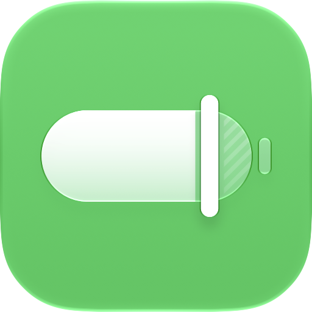
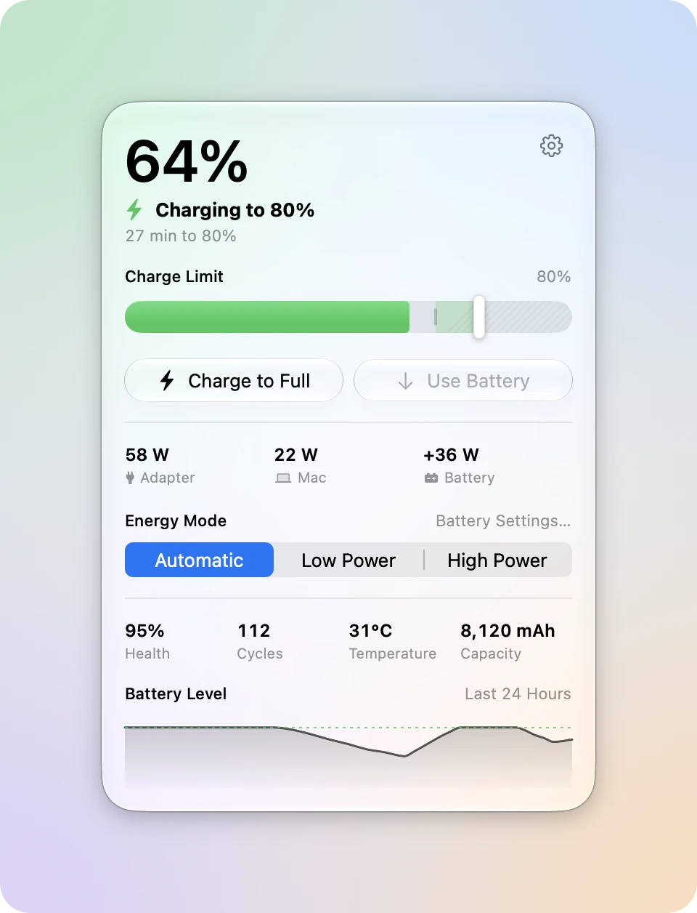
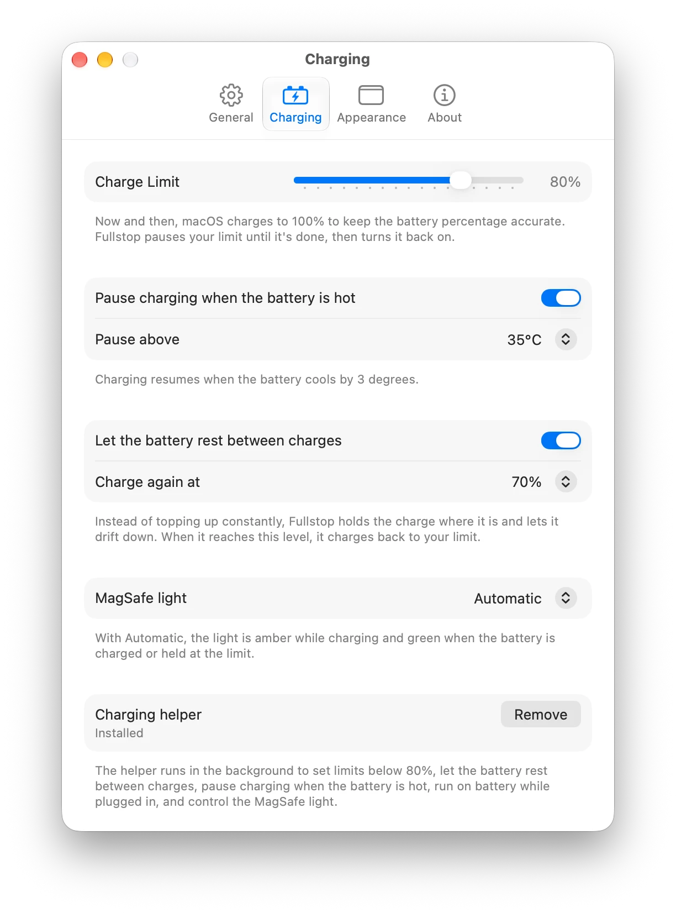
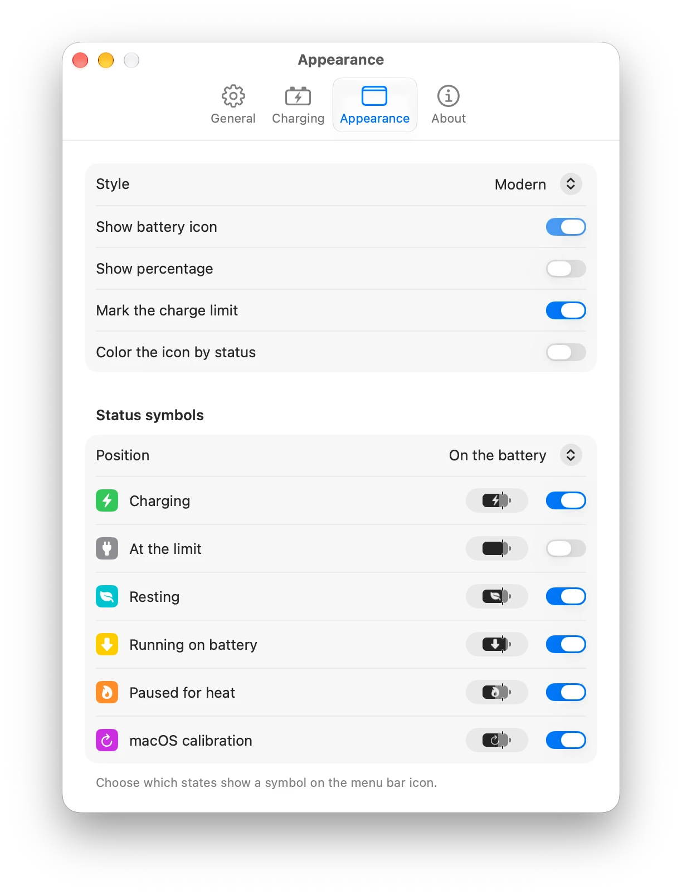

<p align="center">
  <picture>
    <source media="(prefers-color-scheme: dark)" srcset=".github/assets/icon-dark.png">
    
  </picture>
</p>

<h1 align="center">Fullstop</h1>

<p align="center">Stop charging where you want, and keep your battery healthy.</p>

<p align="center">
  <a href="https://github.com/firatciftci/fullstop/releases/latest"><b>Download for macOS</b></a>
  &nbsp;·&nbsp;
  <a href="https://github.com/firatciftci/fullstop/actions/workflows/ci.yml"></a>
</p>

<p align="center">
  <picture>
    <source media="(prefers-color-scheme: dark)" srcset=".github/assets/panel-dark.webp">
    
  </picture>
</p>

Fullstop lives in your menu bar and stops your Mac from charging past the limit you choose. Lithium-ion batteries wear faster when they sit at a full charge, so if your Mac is plugged in most of the day, a limit of 80% or lower helps the battery last longer. Fullstop works with the charge limit built into macOS instead of fighting it, so you can leave Optimized Battery Charging on or off.

## Highlights

### Any limit from 20% to 100%

Drag the slider in the panel to set your limit. From 80% to 100%, Fullstop sets the charge limit built into macOS, so you don't need to install anything else. Lower limits use a small helper that runs in the background.

When you need the whole battery, click Charge to Full. Your limit comes back when you unplug. To bring the charge down while you stay plugged in, click Use Battery, and your Mac runs on battery until it reaches your limit.

### Gentler charging

<p align="center">
  <picture>
    <source media="(prefers-color-scheme: dark)" srcset=".github/assets/charging-dark.webp">
    
  </picture>
</p>

- Rest between charges: instead of topping up all the time, Fullstop lets the battery drift down to a level you choose before it charges back to your limit.
- Heat pause: charging stops when the battery gets hotter than a temperature you pick, from 30 to 45 °C, and starts again once it cools by 3 degrees.
- MagSafe light: amber while charging and green when the battery is charged or held at your limit, or off.
- macOS calibration: now and then, macOS charges to 100% to keep the battery percentage accurate. Fullstop pauses your limit while that happens and turns it back on afterward.

### A battery icon that tells you what's happening

<p align="center">
  <picture>
    <source media="(prefers-color-scheme: dark)" srcset=".github/assets/appearance-dark.webp">
    
  </picture>
</p>

Pick a Modern or Classic battery, show the percentage on it or next to it, and mark where your limit sits. Small symbols show when the battery is charging, resting, running on battery, cooling down, or calibrating. You can color the icon by status, and it turns yellow in Low Power Mode, like the battery icon in macOS.

### And more

- Power flow: see how many watts come from the adapter, how much your Mac uses, and how much goes into or out of the battery.
- Energy Mode: switch between Automatic, Low Power, and High Power for the power source you're on.
- Battery details: health, cycle count, temperature, capacity, and a chart of the battery level over the last 24 hours.
- Shortcuts and Siri: set the charge limit, charge to full, or get the battery status.
- Keyboard shortcut: show Fullstop from anywhere with a shortcut you set in Settings.

## Install

Fullstop needs a Mac with Apple silicon and macOS 27 or later.

1. Download `Fullstop.dmg` from the [latest release](https://github.com/firatciftci/fullstop/releases/latest).
2. Open it and drag Fullstop to your Applications folder.
3. Open Fullstop and set your limit. To use a limit below 80%, Rest, the heat pause, Use Battery, the MagSafe light, or Energy Mode, install the helper when Fullstop asks, then approve it in System Settings > General > Login Items & Extensions.

Fullstop updates itself. Each release is signed with a Developer ID, notarized by Apple, and has a build attestation you can check:

```sh
gh attestation verify Fullstop.dmg --repo firatciftci/fullstop
```

## Privacy

Fullstop has no accounts, analytics, or servers of its own. Everything it reads about your battery stays on your Mac. The only network requests are update checks, which go to GitHub.

## Build from source

You need Xcode 27 and [Homebrew](https://brew.sh).

```sh
git clone https://github.com/firatciftci/fullstop.git
cd fullstop
brew bundle
xcodegen generate
open Fullstop.xcodeproj
```

The Xcode project is generated from `project.yml`, so change that file instead of the project settings and run `xcodegen generate` again. To build without a signing team, pass `CODE_SIGNING_ALLOWED=NO` to `xcodebuild`. The helper only installs from a build signed with a Developer ID or Apple Development certificate, so unsigned builds are limited to charge limits from 80% to 100%.

To see sample battery data instead of your own, for example when taking screenshots, launch with `-demo`. Add `-light` or `-dark` to pick an appearance. Demo mode never changes how your Mac charges.

```sh
open Fullstop.app --args -demo -dark
```

Before you open a pull request, run the same checks as CI:

```sh
tools/check.sh
```

See [CONTRIBUTING.md](CONTRIBUTING.md) for more.

## License

[MIT](LICENSE)
